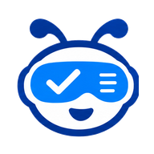
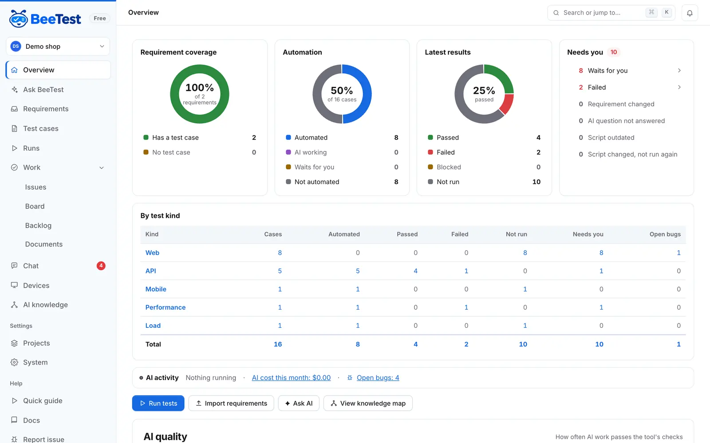
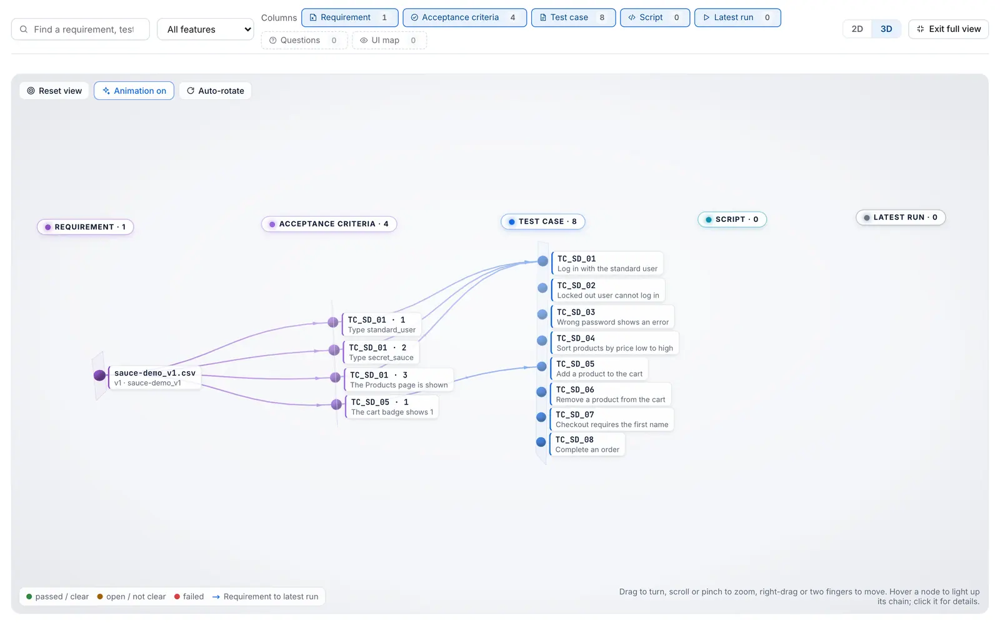
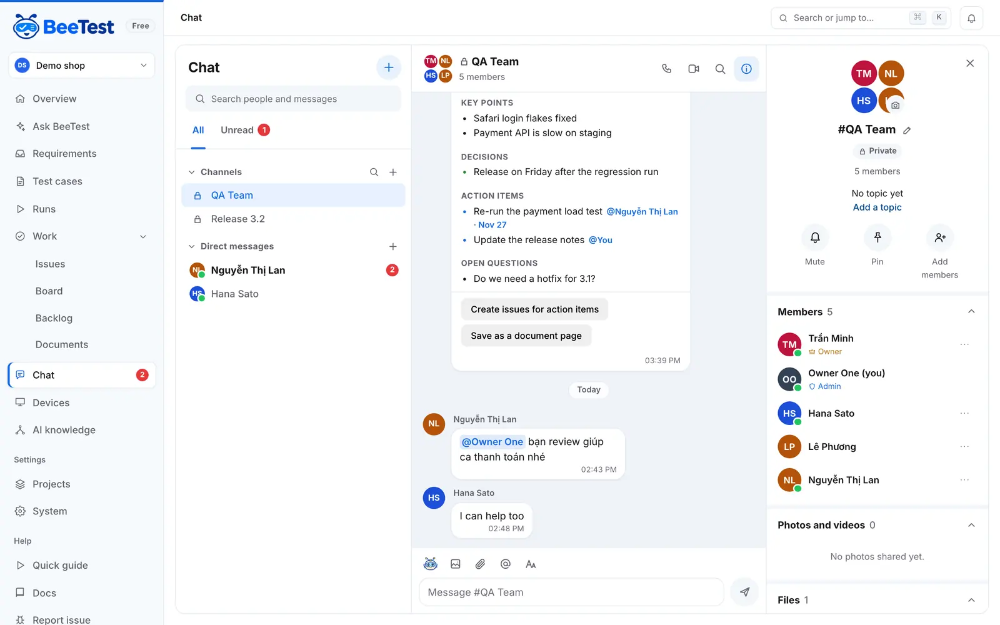

<p align="center">
  
</p>

<h1 align="center">BeeTest</h1>

<p align="center">
  <b>The AI QA agent for your whole test process</b>: requirements, test cases, automated scripts, runs and reports,
  in one desktop app for macOS and Windows.
</p>

<p align="center">
  <a href="https://github.com/shaunhuynhaegistack/BeeTest/releases/latest"></a>
  <a href="https://github.com/shaunhuynhaegistack/BeeTest/releases"></a>
  <a href="https://discord.gg/xrbspQ5gDY"></a>
  <a href="https://github.com/shaunhuynhaegistack/BeeTest/stargazers"></a>
</p>

<p align="center">
  <a href="https://github.com/shaunhuynhaegistack/BeeTest/releases/latest"><b>⬇ Download the latest release</b></a> ·
  <a href="https://discord.gg/xrbspQ5gDY"><b>💬 Join the Discord</b></a> ·
  <a href="https://beetest.cloud">Website</a> ·
  <a href="https://beetest.cloud/pricing/">Pricing</a>
</p>

---

This repository hosts the **BeeTest desktop installers** and their release notes. It does not contain the BeeTest
source code. Download the installers from [Releases](https://github.com/shaunhuynhaegistack/BeeTest/releases).

> **Tester release.** BeeTest 3.0.1 is an early version for testers. Please report anything that looks wrong (see
> [Reporting issues](#reporting-issues)).



## Download

Latest version: **3.0.1** (2026-11-23)

| Your computer | File | |
|---|---|---|
| Mac with Apple silicon (M1, M2, M3, M4 …) | `BeeTest-3.0.1-mac-arm64.dmg` | [Download](https://github.com/shaunhuynhaegistack/BeeTest/releases/download/v3.0.1/BeeTest-3.0.1-mac-arm64.dmg) |
| Mac with an Intel processor | `BeeTest-3.0.1-mac-x64.dmg` | [Download](https://github.com/shaunhuynhaegistack/BeeTest/releases/download/v3.0.1/BeeTest-3.0.1-mac-x64.dmg) |
| Windows 10 / 11, 64-bit (installer) | `BeeTest-Setup-3.0.1-win-x64.exe` | [Download](https://github.com/shaunhuynhaegistack/BeeTest/releases/download/v3.0.1/BeeTest-Setup-3.0.1-win-x64.exe) |
| Windows 10 / 11, 64-bit (portable, no install) | `BeeTest-3.0.1-win-x64-portable.zip` | [Download](https://github.com/shaunhuynhaegistack/BeeTest/releases/download/v3.0.1/BeeTest-3.0.1-win-x64-portable.zip) |

Not sure which Mac you have? Apple menu › **About This Mac**. "Chip Apple M…" means Apple silicon (arm64).

Each release also has `SHA256SUMS.txt` (to check a download) and `latest.json` (the same list in machine-readable form).

## What BeeTest does

- **Requirements to tests.** Import requirements (documents, Jira, Linear, OpenAPI). The AI drafts test cases, and
  you approve them.
- **Automation with AI.** BeeTest writes and repairs Playwright scripts for **Web, API, Mobile, Performance, Load and
  Flow** tests, runs them, and shows step-by-step screenshots, videos and traces.
- **Knowledge map.** Every requirement is traced to its acceptance criteria, test cases, scripts and latest runs,
  in 2D or 3D. **Ask BeeTest** answers questions about the project from the knowledge you approved.
- **Work.** Issues, a board, backlog and sprints, and document pages, with two-way sync to **Jira** and **Linear**.
- **Reports.** Overview of coverage, automation progress and results by test kind; run comparison between two
  environments; export test cases to Excel.
- **Teams (Pro).** Slack-like channels and direct messages, voice / video calls with screen sharing, live captions
  with translation, and AI meeting summaries with action items.

| Knowledge map (3D) | Team chat (Pro) |
|---|---|
|  |  |

## System requirements

| | macOS | Windows |
|---|---|---|
| Operating system | macOS 12 Monterey or later | Windows 10 / 11, 64-bit |
| Processor | Apple silicon or Intel | x64 |
| Memory | 8 GB (16 GB recommended) | 8 GB (16 GB recommended) |
| Free disk space | 5 GB (app, local MySQL, test browsers) | 5 GB |
| Network | Internet on the first launch (it downloads Node.js, MySQL and the Playwright browsers) | same |

## Install on macOS

1. Download the `.dmg` for your Mac (see the table above).
2. Open it and drag **BeeTest** into **Applications**.
3. The app is **not signed or notarized by Apple yet**, so macOS blocks the first launch. Do one of these, once:
   - In Finder › Applications, **right-click (or Control-click) BeeTest › Open › Open**.
   - On macOS 15 or later, if there is no Open button: **System Settings › Privacy & Security**, scroll down and click
     **Open Anyway** for BeeTest, then open it again.
   - Or in Terminal:
     ```bash
     xattr -dr com.apple.quarantine /Applications/BeeTest.app
     ```
4. On the first launch, create your account, then choose where BeeTest keeps its data: a **local MySQL** (installed
   in one click) or a **cloud database**.

## Install on Windows

1. Download `BeeTest-Setup-3.0.1-win-x64.exe` and open it.
2. The app is **not code-signed yet**, so Microsoft Defender **SmartScreen** may say "Windows protected your PC".
   Click **More info › Run anyway**.
3. Follow the installer (you can choose the install folder), then start BeeTest from the Start menu.
4. If you cannot run an installer, use `BeeTest-3.0.1-win-x64-portable.zip`: unzip it and run `BeeTest.exe`.

## Check a download (optional)

Compare the SHA-256 of the file with the line for it in `SHA256SUMS.txt` of the same release.

macOS:

```bash
shasum -a 256 ~/Downloads/BeeTest-3.0.1-mac-arm64.dmg
```

Windows (PowerShell):

```powershell
Get-FileHash "$env:USERPROFILE\Downloads\BeeTest-Setup-3.0.1-win-x64.exe"
```

## Update

There are no automatic updates yet. Download the new version and install it over the old one. Your accounts,
projects and settings are kept: they live in your user data folder, not in the app.

## Free and Pro

| | Free | Pro |
|---|---|---|
| Users | 1 | 2 or more (per seat) |
| Database | Local MySQL or cloud | Cloud / public database (shared by the team) |
| Testing, AI automation, Work, reports | ✓ | ✓ |
| Team chat, calls, captions, meeting summaries | | ✓ |
| Price | Free | $10 per user / month, or $7 per user / month billed yearly |

Upgrade inside the app: **Profile › Plan**. See [beetest.cloud/pricing](https://beetest.cloud/pricing/).

## Community and early testers

- **⭐ Star this repository** to get notified about every new release.
- **💬 [Join the BeeTest Discord](https://discord.gg/xrbspQ5gDY)**: ask questions, share what you tested, vote on
  features and meet the team.
- **🎁 Early Tester program:** report a real bug (in the app, or in the Discord `#issues` forum) and get **3 months of
  BeeTest Pro**.
- Questions and ideas are also welcome in [GitHub Discussions](https://github.com/shaunhuynhaegistack/BeeTest/discussions).

## Reporting issues

In the app, click **Report issue** in the left sidebar. Describe what you did, what you expected and what happened,
and attach screenshots if they help. You see a preview of exactly what is sent before it goes to the BeeTest team.

The app log is under **Help › Open the log**.

## Known limitations (3.0.1)

- The app is not code-signed (macOS not notarized, Windows without a certificate), so the first-launch warning is
  expected.
- Buying Pro needs the BeeTest billing service to be online. Until it is, the Upgrade dialog says that billing cannot
  be reached; testers who need Pro can ask for a test license key and enter it in **System › License**.
- Pro features need a cloud database; a local MySQL is for the one-person Free plan.
- The first launch downloads Node.js, MySQL and the Playwright browsers, so it needs the Internet and a few minutes.
- The local MySQL keeps running in the background after BeeTest quits, so the next start is quick.

## Release notes

- [3.0.1](RELEASE_NOTES.md#beetest-301)
- [3.0.0](RELEASE_NOTES.md#beetest-300)

---

<p align="center">Created by BeeTest · <a href="https://beetest.cloud">beetest.cloud</a></p>
